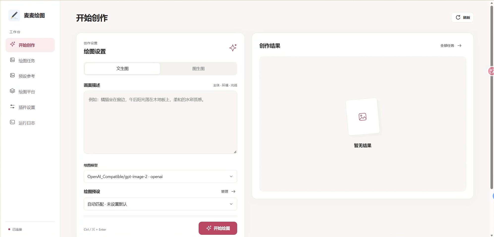
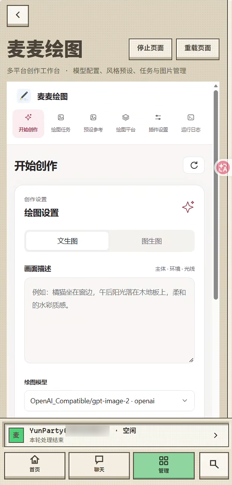
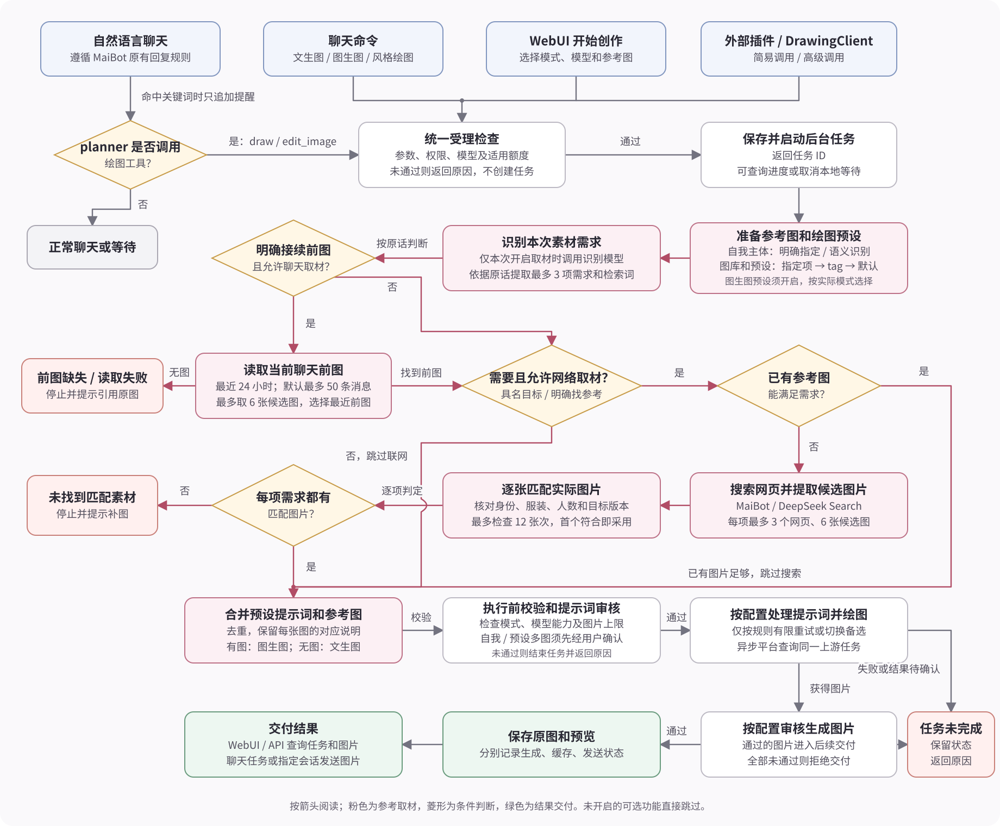

<div align="center">


# 麦麦绘图

   

**❤️为 MaiBot 提供多平台聚合绘图能力，内置现代化 WebUI 工作台与聊天指令支持❤️**

</div>

- **双端交互支持**：支持聊天指令与可视化 WebUI 双向操作，自由输入提示词、上传参考图并切换画风预设
- **多平台灵活管理**：支持多平台及同平台多实例配置，密钥、地址、参数完全独立，支持首选模型与按序备用切换
- **任务看板与排查**：后台异步执行，支持随时切页查询进度、浏览原图与失败日志，大图生成无需死守页面
- **精细化控制与模板**：可视化配置群聊／私聊额度、内容审查规则与黑白名单；统一管理文生图、图生图预设，文字模板可逐条勾选跨模式应用
- **自我参考与素材**：默认关闭的 tag 自我图库、指定默认图、用途明确的多图配置，以及独立开关的聊天／网络素材搜索识别
- **开箱即用的联动 API**：提供统一的任务调用接口与独立 `DrawingClient` 实现，方便第三方插件快速接入，详见[插件联动](./docs/integration.md)

## 🩷 问题反馈&功能建议
| 方式 | 联系 |
| :--: | :--: |
| Github Issue | [跳转](https://github.com/WhiteCloudOL/maimai-drawpic-plugin/issues) |
| QQ群 | [637174573](https://qm.qq.com/q/3f2bdkDsyW) |


## ✨ 工作台预览

截图中的模型配置仅作示例。



<details>
<summary>📱 查看移动端预览</summary>



</details>

---

## 🔗 相关联动插件

### 🌾 [麦生活](https://github.com/octmicy/Mai_life/tree/main)

**作者：**[octmicy](https://github.com/octmicy)

给 AI 角色“麦麦”一条真正在过的生活线

Mai_life 是 MaiBot 的生活陪伴插件。它让麦麦拥有精力、饥饿、心情、睡眠与梦境，根据人格生成每日日程，会道晚安、会被叫醒、会写日记。每个 QQ 用户拥有独立的关系温度与隐私边界，互动不是一次次问答，而是一天一天攒下来的“过日子”。

🎨 绘图联动：生活被“画”下来

麦麦不只记住生活，还会把生活画出来。插件可选接入麦麦绘图联动，在检测到值得分享的生活时刻时，引导麦麦把当下画面画成手机随手拍风格的照片，并支持参考图直发。生活时间线上的场景、心情与见闻，因此可以从文字变成可保存、可分享的视觉碎片，让陪伴多一层“随手记录”的温度。

---

## ⚡ 快速导航
[安装说明](#-安装) · [快速上手](#-快速上手) · [处理流程](#-插件处理流程) · [支持平台](#-支持平台) · [聊天命令](#-聊天命令) · [配置与特性](#-配置与高级特性) · [常见问题](#-常见问题)

## 📦 安装

> [!TIP]
> 无论哪种方式，升级旧版本前均建议先备份原插件目录与数据配置。详见 [升级与恢复指南](docs/configuration.md#升级迁移与冲突恢复)

### 方式一：源码安装
在 MaiBot 根目录下执行：
```bash
cd plugins
git clone https://github.com/WhiteCloudOL/maimai-drawpic-plugin.git
```
完成后重启 MaiBot 或重载插件，在 WebUI 扩展页面打开 **麦麦绘图** 即可。

### 方式二：插件市场安装(⭐推荐)
在 MaiBot 插件市场中直接搜索并安装，安装后可在插件管理中直接查看版本与更新。

---

## 🚀 快速上手

首次使用前，请准备好绘图服务的 API Key 与可用模型（ComfyUI 用户需准备好 API 格式工作流）。

1. **添加平台**：进入 WebUI **绘图平台 → 添加平台**，选择平台类型
2. **配置连接**：设置自定义平台名称，填入 API Key、服务地址与可用模型 ID，保存后即刻生效
3. **文生图测试**：切换至 **开始创作 → 文生图**，输入 Prompt，挑选模型并点击 **开始绘图**
4. **查看成果**：在创作区或 **绘图任务** 列表查看进度与原图。若需发送到群聊，展开表单底部的发送选项即可

> 图生图支持上传参考图并在提示词中描述修改点。若模型要求公网 URL，需先将源图托管至可访问的公网地址。[完整使用指南 →](docs/usage.md)

---

## 🧭 插件处理流程

聊天、命令、WebUI 和外部插件共用绘图执行服务；参考取材按本次请求和已开启的功能使用。

[](assets/diagrams/plugin-flow.svg)

点击流程图可查看大图。关键判断如下：

| 环节 | 触发条件和处理方式 |
| :--- | :--- |
| **planner 决策** | MaiBot 先按原有回复规则进入规划；触发关键词仅追加提醒，是否调用 `draw` / `edit_image` 仍由 planner 判断。命令、WebUI 和外部 API 可直接提交绘图，不经过这次决策。 |
| **自我参考** | 须先开启功能。本次明确要求描绘机器人时使用自我图库；`auto` 根据用户原话和机器人称呼识别主体，无法确定时停止并要求说清楚。绘图关键词本身不能判定主体。 |
| **绘图预设** | 先使用指定名称；未指定时按当前模式匹配 tag，无命中再用默认预设。图生图预设默认关闭；文生图预设只有勾选“同时应用到图生图”才可用于图生图。 |
| **聊天取材** | 仅在明确继续修改、重新生成前图，且前图尚未提供、本次允许聊天取材时读取。范围为当前聊天最近 24 小时，默认最多 50 条消息，可设 1～200 条；最多读取 6 张候选图，选择最近前图。不会专门验证这张是否就是用户所指的前图，回复目标原图更准确。 |
| **网络取材** | 须点名已有角色、品牌型号、特定物件，或明确要求寻找参考图，并开启本次网络来源；已有图片满足需求时不搜索。识别模型提取检索词，对象必须来自用户原话；每项最多搜索 3 个网页、下载 6 张候选图。机器人使用自我图库，用户本人需提供照片，不用同名网图替代。 |
| **图片匹配** | 已有 MaiBot 图片描述时先判断描述；明确符合或不符则直接采用判断，信息不足或没有描述时再把真实图片交给识别模型。核对主体、用途、服装、人数和目标版本，逐项采用第一张符合的图片；候选耗尽仍不符则停止并提示补图。用户选定的自我参考和预设图不统一重新审核身份，模型判断也不能保证所有细节正确。 |
| **生成和交付** | 合并后有真实图片则走图生图，无图则走文生图；强制文生图不隐式加图，强制图生图缺图时报错。执行前校验模式、模型能力、图片上限和需要的多图确认；提示词、结果审核分别按开关执行。通过审核的图片用于缓存和交付，缓存状态、发送状态单独记录。 |

聊天工具默认使用工作台已开启的素材来源，外部 API 需显式指定。取材最多识别 3 项需求、检查 12 张次候选，素材准备限时 90 秒；合并后最多 8 张源图、总计 40 MiB。识别模型建议选择快速多模态模型，可跟随 `planner` / `replyer` / `vlm` 或指定已配置的具体模型。

仅明确允许的错误会按设置有限重试或切换备选；上游已受理或结果不确定时不重新生成。任务可查询进度或取消本地等待，取消不保证终止上游生成或计费。

---

## 🎨 支持平台

各平台均支持添加多个命名实例，按需启用：

| 平台 | 文生图 / 图生图 | 特性与主要限制 |
| :--- | :--- | :--- |
| **OpenAI / 兼容接口** | 视模型支持 | 支持各类兼容 OpenAI 规范的中转站与直连 |
| **Google Gemini** | 视模型支持 | 支持的模型参考图数量有所不同 |
| **智谱 AI** | 文生图 | 默认内置模型 `glm-image` |
| **MiniMax** | 全部支持 | 默认 `MiniMax-H3-Image`；image-01 支持主体参考 |
| **阿里百炼** | 视模型支持 | 可灵/Vidu 等编辑类模型要求原图提供公网 URL |
| **火山引擎** | 视模型支持 | 适配 Seedream 体系模型与校验能力 |
| **硅基流动** | 视模型支持 | 生成与图像编辑模型通常独立区分 |
| **NovelAI / NovelAPI** | 全部支持 | 默认开启反向词与多角色处理；图生图参考图为 1 张 |
| **Agnes AI** | 全部支持 | Image 2.0 采用像素尺寸；2.1 / 2.5 支持 1K–4K 及常用比例 |
| **ComfyUI** | 视工作流支持 | **必须**导出并使用 API 格式工作流 JSON |

详细配置与各家额度限制请查阅 [各平台最小配置与限制说明](docs/platforms.md)

---

## 💬 聊天命令

可在聊天中直接使用快捷指令发起作画或调整状态：

```text
/绘图 帮助
/绘图 模型
/绘图 文生图 夜晚的海边灯塔，水彩插画
/绘图 图生图 保留主体，把背景改成樱花树林 [附带图片或回复原图]
/绘图 风格 水彩 一座森林小屋
/绘图 状态
```

> [!NOTE]
> 图生图需附带图片或引用含有图片的消息。更多高级用法（如反向词过滤、NAI 专用语法、额度限制、英文别名等）详见 [完整命令用法表](docs/usage.md#聊天命令)。

---

## ⚙️ 配置与高级特性

创作相关功能集中在 **预设参考**，包含绘图预设、自我参考和素材来源；**插件设置**管理运行、审核、权限额度。各页面分类共享草稿，通过底部“保存全部设置”统一保存。

自我参考页的**触发关键词**支持多个标签，例如“自拍”“画”“绘图”。MaiBot 放行本轮处理后，命中当前用户发言才提醒模型判断是否调用绘图工具；不会用关键词唤醒回复或直接套用自身图片。清空关键词可关闭提醒。

- **模型与预设覆盖**：支持按模型覆盖分辨率、OpenAI 兼容接口模式，并配置平台扩展参数；支持常用尺寸下拉与自定义宽高
- **硅基流动水印**：平台实例可单独配置显式「AI 生成」水印，默认开启；关闭时使用官方请求头，详见[平台说明](docs/platforms.md#硅基流动)
- **风格模板**：模板中 `{prompt}` 与 `{negative_prompt}` 为占位符，支持一键注入固定画风，按文生图/图生图分别选择预设；上传参考图片后直接关联到当前图生图预设，以图库卡片展示、弹窗编辑用途
- **会话历史同步**：可在「插件设置 → 运行设置」开启 *生成图片同步到会话历史*，开启后发至聊天的图片可供视觉 Planner 查看
- **聊天取材范围**：仅明确接续前图时读取聊天；在“预设参考 → 素材来源”设置消息搜索上限，推荐默认 50 条（1～200），仅查找当前聊天最近 24 小时
- **网络素材搜索（测试）**：可选择 MaiBot 搜索服务或 DeepSeek Search API，按需求搜索网页并提取候选图片；识别模型支持 planner、replyer、vlm 或自定义模型
- **权限与审核**：内置提示词与图片双重审查，支持 `vlm` / `planner` / `replyer` 模型，支持分别设置群聊／私聊黑白名单
- **缓存与日志**：在 MaiBot 宿主插件配置页可限制图片缓存（默认 300MB）与日志容量（默认 10MB），重要生成图建议本地另存

配置与预设均存储为标准 UTF-8 JSON，高级玩法详见 [手动编辑配置指南](docs/manual-configuration.md)。

---

## ❓ 常见问题

- **模型列表下拉为空？**<br>
  检查该平台是否已开启胶囊开关，并确认填写的模型 ID 与账号实际开通的模型权限一致
- **图生图提示“能力校验不通过”？**<br>
  所选模型可能不支持多图输入，或部分国内平台要求参考图必须是公网 HTTP/HTTPS 直链
- **请求超时或任务状态未更新？**<br>
  工作台取消仅终止本地等待，上游执行与计费以服务商账单为准；可先前往服务商控制台核对任务
- **图片无法下载 / 报 IP 校验异常？**<br>
  使用 TUN/Fake-IP 代理或内网私有图床时，在「插件设置 → 运行设置」开启 *忽略图片地址 IP 校验*
- **表单填写内容丢失？**<br>
  偏好设置切换分类会保留草稿；离开未保存的配置页会提示确认。已提交任务可在“绘图任务”中查询；提交回执未确认时使用“恢复原提交”找回原任务
- **ComfyUI 报错无法执行？**<br>
  使用 ComfyUI 菜单中的「导出（API 格式）」保存 JSON。默认放在 `MaiBot\data\plugins\maimai-drawpic-plugin\workflows`，文生图设置填写 `data/workflows/t2i.json`，图生图填写 `data/workflows/i2i.json`；`MaiBot` 为主程序根目录。详见 [ComfyUI 配置](docs/platforms.md#comfyui-本地工作流)

---

## 📚 完整文档与扩展

- **用户指南**：[完整使用指南](docs/usage.md) ｜ [平台接入配置](docs/platforms.md) ｜ [配置与数据迁移](docs/configuration.md)
- **开发者接入**：[插件联动与 DrawingClient](docs/integration.md) ｜ [独立客户端](clients/README.md)
- **适配器支持**：[官方 QQ 机器人与 SnowLuma 适配说明](docs/qq-adapters.md)

---

## 开源协议

- 插件主体采用 [AGPL-3.0](LICENSE) 协议。
- 独立客户端 `clients/maimai_drawing_client/` 单独采用 [MIT](clients/maimai_drawing_client/LICENSE) 协议，复制使用时保留许可证和版权声明。
